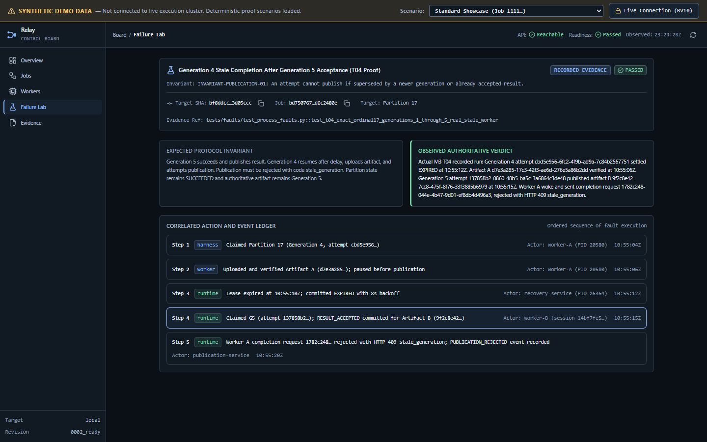
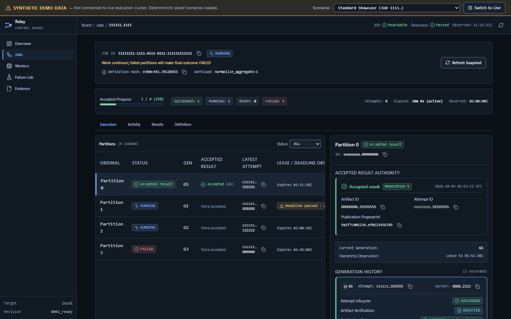
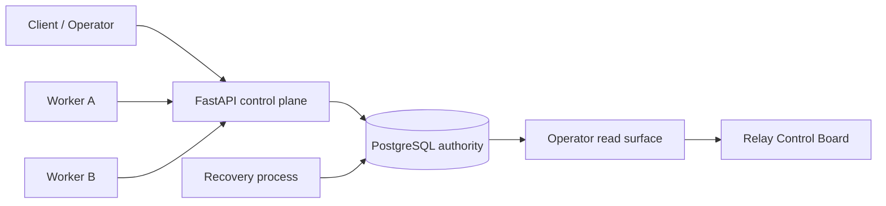
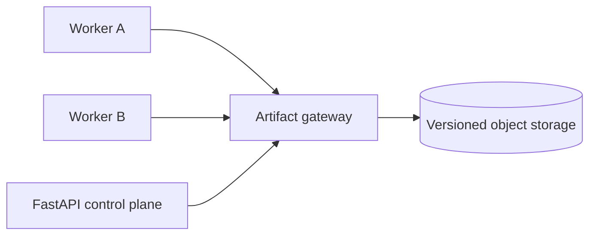
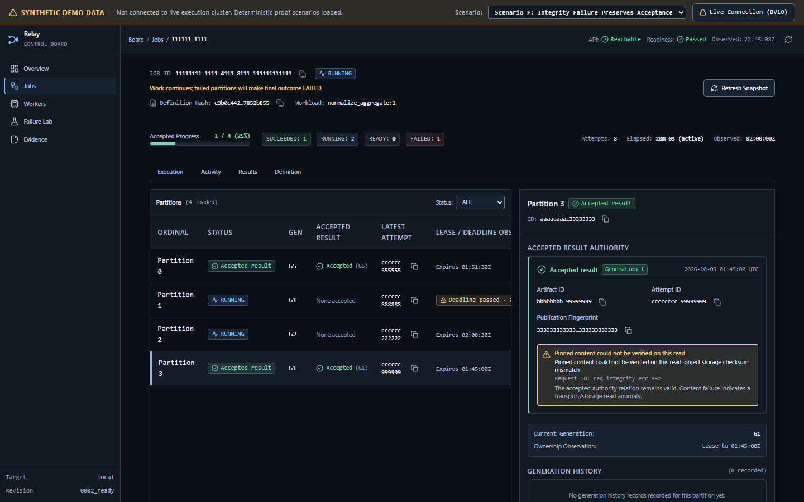
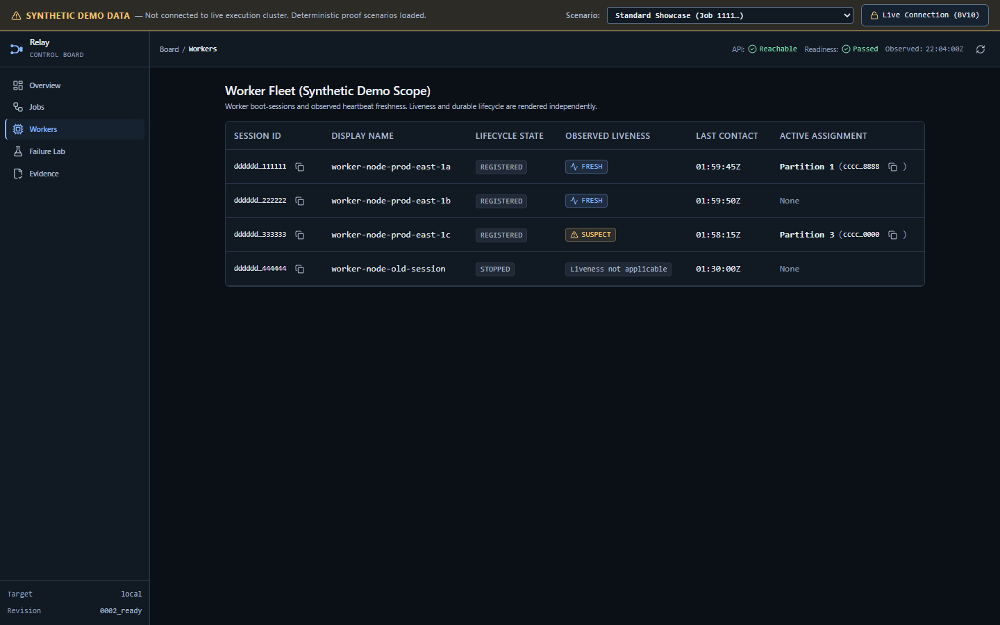
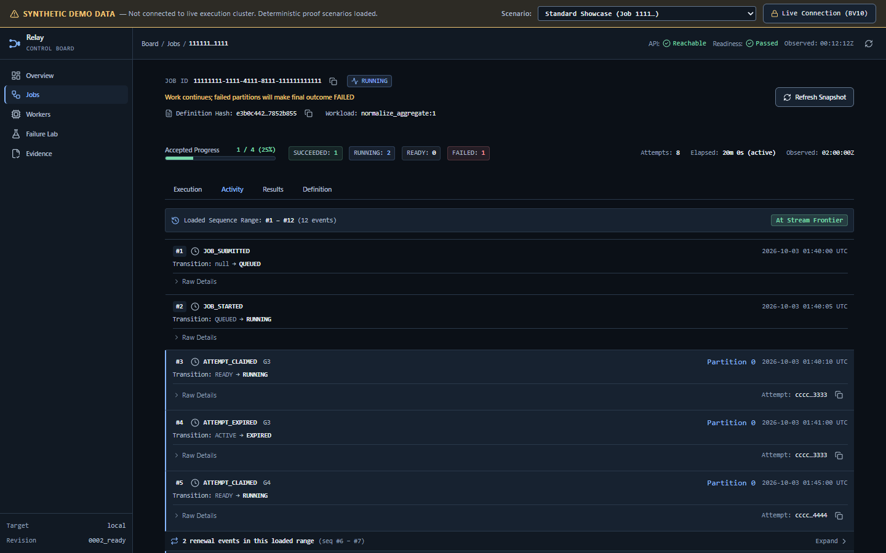
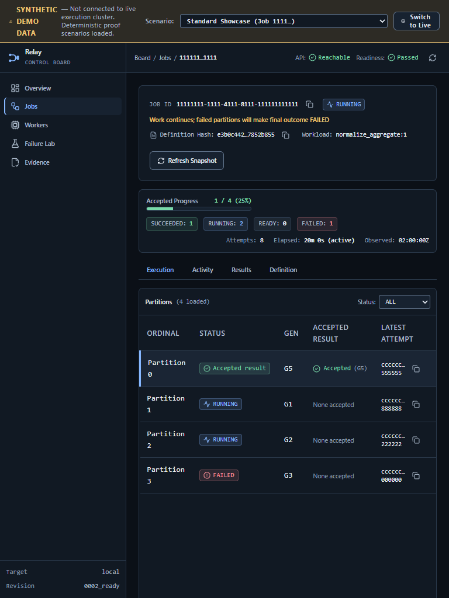
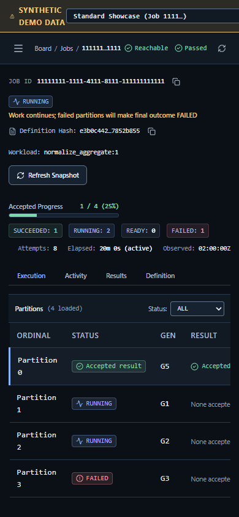

# Relay

**Fault-tolerant distributed execution with authority over computation.**

Relay is a partitioned batch execution platform built around one question:

> **Which computation result is authoritative when duplicate workers, retries, lease expiry, crashes, and stale attempts race?**

Relay deliberately permits duplicate computation.

What it does **not** permit is ambiguous authority.

A worker may compute a perfectly valid result, upload a verified artifact, disappear long enough to lose its lease, and later return after another worker has recovered the partition and published a newer result.

That older computation is still valid computation.

It is simply no longer authoritative.

That distinction is the center of Relay.

---

## The failure that explains Relay

Consider one partition.

```text
Generation 4
    Worker A owns the partition
    Worker A computes Artifact A
    Artifact A is verified
    Worker A stops renewing
            |
            v
    lease expires
            |
            v
Recovery settles generation 4
            |
            v
Generation 5
    Worker B claims the partition
    Worker B computes Artifact B
    Artifact B is verified
    Artifact B is accepted
            |
            v
Worker A wakes up
    attempts to publish Artifact A
            |
            v
REJECTED AS STALE
```

Artifact A did not become corrupt.

Worker A did not necessarily compute the wrong answer.

The system changed **who was allowed to publish**.

Relay therefore separates:

```text
execution
verification
ownership
generation
publication
acceptance
```

instead of collapsing them into a single "task succeeded" state.

<p align="center">
  
</p>

---

## The shortest explanation of Relay

Relay models execution as:

```text
Job
  ↓
Partitions
  ↓
Attempt generations
  ↓
Immutable attempt artifacts
  ↓
Fenced publication
  ↓
Authoritative accepted results
```

Each partition may be executed more than once.

Each fresh claim advances the generation.

Artifacts belong to exact attempts and generations.

Artifact verification does not establish authority.

Only a fenced PostgreSQL state transition can accept a result.

The safety goal is:

> **At most one authoritative accepted result exists for each partition of an immutable job version.**

Relay does **not** claim universal exactly-once execution.

---

# Control Board

Relay includes a read-only operator product called the **Control Board**.

The Control Board is designed to answer:

- What is running?
- Which worker currently owns a partition?
- Which generations existed?
- Which attempts became stale?
- Which artifact was verified?
- Which result became authoritative?
- What failed?
- What recovered?
- What evidence supports that conclusion?

<p align="center">
  
</p>

The UI deliberately distinguishes:

```text
recorded lifecycle state
observed liveness
latest attempt
current generation
verified artifact
accepted result
```

Those are related facts.

They are not interchangeable.

The interface is intentionally information-dense because Relay is an operator tool, not a generic analytics dashboard.

---

# A generation is not a result

One of the easiest mistakes to make in a distributed execution system is to assume:

```text
latest attempt = authoritative attempt
```

or:

```text
highest generation = accepted generation
```

Relay does not make either inference.

A current generation can still be running.

A previous generation can have produced a verified artifact without ever becoming authoritative.

A result becomes accepted only through the publication protocol.

This is why the Control Board renders accepted authority separately from attempt history.

---

# System architecture

Relay separates **execution authority** from **artifact storage**.

PostgreSQL decides which attempt currently owns a partition and which result is authoritative. Object storage preserves immutable attempt outputs, but the existence of an object never makes it authoritative.

## Authority plane



The authority plane answers:

```text
Who owns this partition?
Which generation is current?
Has the lease expired?
May this attempt publish?
Which result was accepted?
```

## Artifact plane



The artifact plane answers:

```text
Which exact bytes did this attempt produce?
Which immutable object version contains them?
Does the stored content still match its recorded digest?
```

The two planes deliberately do not collapse into each other:

```text
artifact exists
≠
artifact verified
≠
result accepted
```

That separation is what allows Relay to retain a valid stale artifact while rejecting it as authoritative computation.
---

# Core correctness model

Relay's execution protocol is built around a few invariants.

## 1. Duplicate computation is allowed

Retries and recovery can legitimately cause multiple attempts to compute the same partition.

Relay does not try to eliminate that fact.

Trying to promise universal exactly-once computation across independent processes and external storage would be misleading.

Instead, Relay controls publication authority.

---

## 2. Claims create generations

Each successful fresh claim creates a monotonically increasing attempt generation.

Conceptually:

```text
generation 1
generation 2
generation 3
generation 4
generation 5
```

Recovery does not manufacture generations.

A new generation appears only when a later worker successfully claims an eligible partition.

---

## 3. Leases bound current ownership

Workers own partitions temporarily.

Ownership is lease-based.

Lease validity is evaluated using fresh PostgreSQL time under authoritative locking.

A worker whose authority has expired cannot newly publish a result simply because it continued computing.

---

## 4. Hard attempt deadlines are immutable

Lease renewal does not extend the attempt's absolute lifetime indefinitely.

The attempt has both:

```text
renewable ownership lease
+
immutable hard deadline
```

This prevents a continuously renewing worker from owning a partition forever.

---

## 5. Artifacts are attempt-specific

Outputs are immutable and generation-specific.

Conceptually:

```text
/jobs/{job_id}/{partition_id}/attempt-{generation}/output.parquet
```

A newer generation does not overwrite the artifact produced by an older generation.

Historical outputs remain distinguishable.

---

## 6. Verification is not acceptance

Relay separates:

```text
artifact uploaded
artifact verified
result accepted
```

A VERIFIED artifact can remain permanently unaccepted.

That matters in recovery cases where a worker successfully wrote output but lost publication authority before completing the fenced acceptance step.

---

## 7. Accepted results are immutable

Once an accepted result exists for a partition, stale or superseded attempts cannot replace it.

The accepted result is a historical authority decision, not a "latest file wins" pointer.

---

# Publication fencing

Publication is the critical state transition.

A completion request binds exact identities including:

```text
job
partition
attempt
generation
artifact
artifact version
content hash
request identity
```

Acceptance rechecks the relevant state under database locks and fresh database time.

The simplified rule is:

```text
if attempt still owns the current generation
and lease/deadline rules still permit publication
and artifact identity is valid
and no accepted result already exists
then
    accept exact result
else
    reject
```

The actual implementation uses transactional guards rather than trusting client-side state.

The linearization point is the final fenced database mutation inside the transaction that commits.

---

# The generation 4 → 5 recovery case

Relay's recorded failure evidence includes a multi-generation scenario specifically designed to prove stale-worker fencing.

The important sequence is:

```text
G4 worker owns partition
        |
        v
G4 produces verified Artifact A
        |
        v
G4 stops renewing before publication
        |
        v
recovery expires G4
        |
        v
G5 worker claims partition
        |
        v
G5 produces Artifact B
        |
        v
G5 publishes successfully
        |
        v
Artifact B becomes authoritative
        |
        v
G4 original completion arrives late
        |
        v
G4 is rejected as stale
```

The system does not delete Artifact A in order to make this true.

Instead:

```text
Artifact A = real historical computation
Artifact B = authoritative accepted result
```

That difference is visible in the product.

---

# Failure recovery

Relay includes an independent recovery process.

Recovery examines eligible abandoned work using authoritative database state.

An expired active attempt can be settled and either:

```text
READY after bounded backoff
```

or:

```text
FAILED after retry exhaustion
```

Only a later successful claim creates the next generation.

Recovery itself does not advance generation numbers.

Multiple recovery processes can operate safely under the same row-lock protocol.

A typical recovery sequence is:

```text
ACTIVE
  ↓
lease expiry
  ↓
EXPIRED
  ↓
retry budget available?
  ├── yes → READY
  └── no  → FAILED
```

This makes failure settlement separate from worker reassignment.

---

# Request uncertainty

A distributed client cannot safely assume:

```text
no response = no effect
```

Relay therefore treats request identity and durable state as part of recovery.

For selected mutation paths, repeated delivery of the **same logical request identity** can be reconciled against previously committed state.

A lost HTTP response does not automatically justify creating a new operation identity.

This matters particularly near publication boundaries.

---

# Artifact integrity

Relay uses versioned object storage.

The storage protocol preserves exact object identities and content hashes.

Accepted result reads verify the pinned object version rather than silently reading "whatever object currently exists at this key."

A missing or corrupt pinned version results in an explicit integrity failure.

It does not cause Relay to:

- substitute another object
- silently update metadata
- recompute the result
- pretend verification succeeded

<p align="center">
  
</p>

Authority and integrity are separate.

A historically accepted result can remain the authoritative result even when its current stored bytes fail an integrity read.

---

# Workers

Workers do not receive direct database credentials.

They do not receive general object-store administration credentials.

The worker supervisor owns the session and transport responsibilities.

Computation executes in a credential-restricted child process.

This creates an intentional separation between:

```text
control-plane authority
worker session
computation process
artifact protocol
```

A workload is not allowed to mutate Relay's database directly simply because it is currently executing a partition.

<p align="center">
  
</p>

---

# Operator visibility

Relay exposes an additive read-only operator surface under:

```text
/v1/operator
```

The current R1 visibility layer contains **16 GET-only routes**.

Supported capability groups include:

| Capability | Purpose |
|---|---|
| `BV01_JOBS_CATALOGUE` | Job catalogue and job detail |
| `BV03_PARTITION_HISTORY` | Partition views and generation history |
| `BV04_ATTEMPT_DETAIL` | Attempt inspection |
| `BV05_ARTIFACT_METADATA` | Artifact metadata and explicit verification |
| `BV06_RESULT_METADATA` | Accepted result metadata |
| `BV07_FLEET_HISTORY` | Worker and worker-history inspection |
| `BV08_TAIL_FILTER_EVENTS` | Job event inspection |
| `BV09_DEFINITION` | Immutable job definition |
| `BV12_OBSERVATION_CLOCK` | Capability and observation metadata |

Operator reads are observational.

They do not transition execution state.

Responses separate recorded state from observed liveness.

They also carry database observation metadata so the frontend does not imply that separate requests form one globally atomic live snapshot.

---

# Control Board product surfaces

The current Control Board includes operator views for:

```text
Overview
Jobs
Job Detail
Activity
Results
Workers
Failure Lab
Evidence
```

The job workspace focuses on partition-level investigation.

<p align="center">
  
</p>

The product preserves distinctions such as:

```text
current generation
latest attempt
accepted generation
accepted artifact
recorded status
observed status
```

rather than inventing missing relationships.

---

# Failure Lab

The Failure Lab presents recorded deterministic scenarios that demonstrate Relay's correctness properties.

It is deliberately labelled as recorded or synthetic evidence where appropriate.

It is not a production chaos-control panel.

The UI does not pretend that clicking a button is crashing real production workers.

The strongest scenario demonstrates the stale-generation problem directly:

```text
G4 verified
G4 loses authority
G5 accepted
G4 returns late
G4 publication rejected
```

<p align="center">
  
</p>

---

# Responsive operator interface

Relay's Control Board is desktop-first because the core workflows involve dense operational state.

The frontend nevertheless has explicit responsive behavior for smaller viewports.

At tablet and mobile widths, low-priority table columns collapse while core authority information remains visible.

<p align="center">
  
  
</p>

The mobile partition table retains the minimum useful investigation state:

```text
partition
status
generation
accepted result
inspection affordance
```

instead of squeezing the entire desktop table into 390 pixels.

---

# Testing

Relay's current recorded backend validation totals **271 passing tests** across the frozen execution kernel and R1 operator visibility suites.

| Suite | Passing tests |
|---|---:|
| R1 operator visibility | 21 |
| M3 faults and recovery | 29 |
| M2 concurrency | 25 |
| M1C publication | 25 |
| Unit | 9 |
| Integration | 28 |
| M1A persistence | 122 |
| M0 infrastructure + storage contract | 12 |
| **Total** | **271** |

The tests use real PostgreSQL for concurrency and persistence behavior.

The storage contract is exercised against the pinned local S3-compatible object store rather than replacing the relevant protocol with SQLite or an in-memory fake.

The test strategy includes:

- real row-lock contention
- concurrent claims
- lease expiry
- stale publication
- repeated completion
- lost-response reconciliation
- process crashes
- competing recovery loops
- retry exhaustion
- immutable artifact identity
- exact-version reads
- storage integrity failures
- operator read semantics

Correctness timing is not presented as throughput benchmarking.

---

# Frontend validation

The frozen Control Board V2 checkpoint is:

```text
e8c5567268b1c82137fada137b179b3e97cb76d0
```

with annotated milestone tag:

```text
relay-frontend-v2-final
```

The final frontend checkpoint passed:

```text
46 / 46 tests
TypeScript typecheck
ESLint
production Vite build
deterministic screenshot capture
```

The screenshot suite contains 15 recorded viewport/product states, including:

- normal job inspection
- lease deadline state
- running job with failed partition
- partial terminal result
- event chronology
- accepted result manifests
- stale-generation failure evidence
- worker observations
- overview
- no accepted result
- integrity failure
- disconnected state
- missing-capability state
- tablet layout
- 390 × 844 mobile layout

---

# Authority versus observation

One of Relay's most important product rules is:

> **Observation does not create authority.**

Examples:

```text
worker appears alive
```

does not necessarily mean:

```text
worker still owns the partition
```

Likewise:

```text
artifact verifies successfully
```

does not mean:

```text
artifact is accepted
```

And:

```text
attempt is the latest attempt
```

does not mean:

```text
attempt produced the accepted result
```

The Control Board preserves those distinctions even when doing so makes the interface slightly more verbose.

That verbosity is intentional.

---

# State versus liveness

Relay also separates durable lifecycle state from observations about current liveness.

For example, an operator may observe that a deadline has passed before the durable recovery transition has settled the attempt.

The UI can therefore show both:

```text
recorded state: ACTIVE
observation: deadline passed
```

without fabricating a transition that has not yet committed.

This is especially important in systems where observation and state mutation happen on different schedules.

---

# Technology

The core implementation uses:

```text
Python 3.12
FastAPI
Pydantic
PostgreSQL
SQLAlchemy
Alembic
psycopg
PyArrow
S3-compatible versioned object storage
Pytest
Docker Compose
```

The Control Board uses:

```text
React
TypeScript
Vite
React Router
TanStack Query
TanStack Table
Tailwind CSS
Vitest
Puppeteer
```

Relay intentionally does not add infrastructure solely for vocabulary.

There is currently no architectural requirement for:

```text
Kafka
Redis
Celery
RabbitMQ
Kubernetes
```

The difficult problem is authority under concurrent execution, not collecting the largest possible technology list.

---

# Local environment

Relay currently targets trusted local development and reproducible testing.

The pinned environment includes PostgreSQL and a locally built versioned MinIO-compatible object store.

Initial setup from PowerShell:

```powershell
Set-Location "C:\Users\adith\OneDrive\Desktop\relay-contract"

python -m venv .venv
.\.venv\Scripts\python.exe -m pip install uv==0.12.21
.\.venv\Scripts\uv.exe sync --locked --cache-dir .cache/uv
.\.venv\Scripts\python.exe scripts/init_env.py

docker compose build minio
docker compose up -d --wait postgres minio
docker compose run --rm minio-setup
docker compose ps
```

`init_env.py` creates the ignored local environment file and refuses to overwrite an existing one.

Do not rerun it casually against an existing environment.

For the exact storage and credential contract, see:

- [`docs/SPEC.md`](docs/SPEC.md)
- [`docs/API.md`](docs/API.md)
- [`docs/M0_EVIDENCE.md`](docs/M0_EVIDENCE.md)

---

# Running a worker

After a verified input and job exist, a worker can be started from another terminal.

```powershell
Set-Location "C:\Users\adith\OneDrive\Desktop\relay-contract"

.\.venv\Scripts\python.exe scripts/run_worker.py `
    --base-url http://127.0.0.1:8000 `
    --polls 1 `
    --complete
```

The worker:

```text
registers
claims one eligible partition
downloads its assigned immutable input slice
executes in a separate child process
reserves an output artifact
uploads the artifact
verifies the artifact
attempts fenced completion
```

The supervisor renews ownership independently.

The computation child does not receive general Relay infrastructure credentials.

---

# Running recovery

The recovery process is independent from worker execution.

```powershell
Set-Location "C:\Users\adith\OneDrive\Desktop\relay-contract"

.\.venv\Scripts\python.exe scripts/run_recovery.py --env-file .env
```

Recovery uses a deliberately narrow credential set.

It does not need worker, object-store administration, or general operator credentials.

Multiple recovery processes can run concurrently under the same authoritative locking protocol.

---

# Running the backend gates

The recorded backend suites are intentionally run as separate invocations.

```powershell
Set-Location "C:\Users\adith\OneDrive\Desktop\relay-contract"

.\.venv\Scripts\python.exe -m pytest tests/operator_visibility -q --maxfail=1
.\.venv\Scripts\python.exe -m pytest tests/faults -q --maxfail=1
.\.venv\Scripts\python.exe -m pytest tests/concurrency -q --maxfail=1
.\.venv\Scripts\python.exe -m pytest tests/publication -q --maxfail=1
.\.venv\Scripts\python.exe -m pytest tests/unit -q --maxfail=1
.\.venv\Scripts\python.exe -m pytest tests/integration -q --maxfail=1
.\.venv\Scripts\python.exe -m pytest tests/persistence -q --maxfail=1
.\.venv\Scripts\python.exe -m pytest tests/infrastructure tests/storage_contract -q --maxfail=1
```

For detailed reproduction evidence, see:

- [`docs/M0_EVIDENCE.md`](docs/M0_EVIDENCE.md)
- [`docs/M1A_EVIDENCE.md`](docs/M1A_EVIDENCE.md)
- [`docs/M1B_EVIDENCE.md`](docs/M1B_EVIDENCE.md)
- [`docs/M1C_EVIDENCE.md`](docs/M1C_EVIDENCE.md)
- [`docs/M2_EVIDENCE.md`](docs/M2_EVIDENCE.md)
- [`docs/M3_EVIDENCE.md`](docs/M3_EVIDENCE.md)
- [`docs/R1_EVIDENCE.md`](docs/R1_EVIDENCE.md)

---

# Running the Control Board

The frontend lives under:

```text
frontend/
```

Install dependencies:

```powershell
Set-Location "C:\Users\adith\OneDrive\Desktop\relay-contract\frontend"

npm install
```

Run the development server:

```powershell
npm run dev
```

Run the frontend validation suite:

```powershell
npm run typecheck
npm run lint
npm run test
npm run build
npm run screenshots
```

The Vite application is configured under the `/board/` base path.

---

# Repository structure

```text
relay-contract/
├── src/relay/
│   ├── api/
│   ├── artifacts/
│   ├── control/
│   ├── db/
│   ├── operator/
│   ├── recovery/
│   ├── worker/
│   └── workloads/
│
├── migrations/
│
├── scripts/
│   ├── worker launcher
│   ├── recovery launcher
│   └── local environment tooling
│
├── tests/
│   ├── infrastructure/
│   ├── storage_contract/
│   ├── persistence/
│   ├── integration/
│   ├── publication/
│   ├── concurrency/
│   ├── faults/
│   └── operator_visibility/
│
├── frontend/
│   └── Relay Control Board
│
├── docs/
│   ├── architecture contracts
│   ├── state machines
│   ├── failure model
│   ├── API contracts
│   ├── milestone evidence
│   └── ui/
│       └── screenshots/
│
├── compose.yaml
├── pyproject.toml
└── README.md
```

---

# Why PostgreSQL is the authority

Relay uses PostgreSQL not merely as a place to store job records, but as the synchronization boundary for execution authority.

The database is where Relay can atomically reason about:

```text
job state
partition state
current generation
current attempt
lease validity
hard deadline
accepted result
request replay identity
```

That is what allows the system to answer:

> Is this exact attempt still allowed to publish this exact artifact now?

Object storage cannot answer that question by itself.

A message queue cannot answer that question by itself.

A worker's local memory cannot answer that question by itself.

The authoritative answer is a transactional relation.

---

# Why object storage is not authority

A worker can successfully upload output and still lose the right to publish it.

Therefore:

```text
object exists
```

cannot mean:

```text
partition succeeded
```

and:

```text
object verified
```

cannot mean:

```text
result accepted
```

Relay retains verified orphan artifacts rather than rewriting history.

That makes failure behavior inspectable.

---

# Why generations matter

Suppose the system identified attempts only by partition ID.

A late worker could then return after reassignment and appear indistinguishable from the current owner.

Generations give every ownership era an explicit identity.

```text
partition 17, generation 4
```

and:

```text
partition 17, generation 5
```

are different authorities even though both refer to the same logical partition.

That makes stale completion mechanically rejectable.

---

# Why not exactly-once execution?

Because duplicate execution can occur before the system has enough information to safely know whether prior work completed.

Relay instead provides a narrower guarantee that it can actually enforce:

```text
duplicate computation may occur

but

stale attempts cannot overwrite newer authority
and
at most one result becomes authoritative
```

This is both more honest and more useful than hiding duplicate execution behind an exactly-once label.

---

# Why immutable artifacts?

If an attempt overwrote:

```text
partition/output.parquet
```

the system could no longer prove which attempt produced which bytes.

Generation-specific versioned artifacts preserve that history.

That enables:

- stale-result inspection
- accepted-result provenance
- integrity verification
- deterministic failure evidence
- post-failure debugging

---

# Why the Control Board does not infer missing facts

An operator UI can accidentally destroy a good backend model by presenting guesses as facts.

Relay avoids that.

The frontend does not infer:

```text
latest attempt == accepted attempt
current generation == accepted generation
verified artifact == accepted artifact
deadline passed == durable expiry transition committed
```

Missing information stays unavailable.

This makes the Control Board an inspection surface rather than an alternate source of truth.

---

# What Relay deliberately does not claim

Relay does not currently claim:

- universal exactly-once execution
- exactly-once external side effects
- arbitrary untrusted workloads
- production multi-tenancy
- production browser authentication
- Kubernetes deployment
- multi-region execution
- distributed PostgreSQL consensus
- complete outage/restart validation
- garbage collection of historical artifacts
- production throughput
- an SLA
- benchmark numbers that have not been measured
- a live chaos controller
- production readiness

Those boundaries are intentional.

The project is strongest when its claims stay inside what the implementation and evidence actually prove.

---

# Current limitations

The current checkpoint has several explicit unfinished areas.

## Browser-live authentication

The backend operator read surface exists.

The browser session/authentication bridge identified as:

```text
BV10_BROWSER_AUTH
```

is still deferred.

The Control Board therefore does not pretend that the existence of backend read routes makes the browser fully live-integrated.

---

## Installation summary and report controller

The following product capabilities remain deferred:

```text
BV02_SUMMARY
BV11_REPORTS_CONTROLLER
```

There is no claim of a complete installation-wide metrics dashboard or live fault-controller product.

---

## Cancellation

The original V1 architecture specifies cancellation semantics, but cancellation is not yet part of the implemented correctness checkpoint described here.

---

## Benchmarks

The repository contains benchmark methodology and planning.

The final preregistered measurement pass has not yet been completed.

Current test durations are correctness observations.

They are not throughput results.

---

## Full release certification

The current repository has:

```text
M0
M1A
M1B
M1C
M2
M3
R1 operator visibility
Control Board V2
```

The remaining lifecycle, measured benchmark, adversarial release, and final public-release work is intentionally not relabelled as complete.

---

# Project status

## Implemented and evidence-backed

```text
✓ architecture and safety contract
✓ PostgreSQL authority
✓ immutable jobs and partitions
✓ worker registration and sessions
✓ atomic claims
✓ lease renewal
✓ immutable hard attempt deadlines
✓ generation fencing
✓ versioned artifact protocol
✓ artifact verification
✓ fenced result publication
✓ accepted-result immutability
✓ request uncertainty handling
✓ crash recovery
✓ bounded retries
✓ stale-worker rejection
✓ deterministic event history
✓ operator read surface
✓ Control Board V2
✓ deterministic failure evidence
✓ responsive operator UI
```

## Still intentionally open

```text
○ cancellation lifecycle
○ BV10 browser-live authentication
○ installation-level summary/report controller
○ final benchmark campaign
○ full release/adversarial certification
```

---

# Engineering philosophy

Relay follows a few principles throughout the system.

### Authority is explicit

Computation does not grant publication authority.

Verification does not grant publication authority.

Queue ownership does not grant publication authority.

Current transactional state grants publication authority.

---

### Historical truth is preserved

A stale artifact is not rewritten into "never existed."

An expired worker is not retroactively treated as if it never owned the partition.

An accepted result is not replaced because something newer appears.

---

### Failure is a state-model problem

Crashes, lost responses, lease expiry, retries, and stale workers are modeled directly.

They are not hidden behind broad `try/except` blocks and optimistic retries.

---

### Missing information stays missing

The backend and frontend both avoid inventing relationships that the stored evidence does not prove.

---

### Technology follows the guarantee

Relay uses PostgreSQL, versioned object storage, independent workers, and a recovery process because the correctness model needs them.

It does not add infrastructure simply because it looks impressive in an architecture diagram.

---

# The question Relay should answer in an interview

If a worker computes a result, freezes, loses its lease, and later wakes up after another worker has completed the same partition:

**why can the old worker not overwrite the new result?**

The answer spans the entire project:

```text
generation identity
+
lease ownership
+
immutable hard deadlines
+
attempt-specific artifacts
+
PostgreSQL locking
+
fresh database time
+
fenced publication
+
immutable accepted-result authority
+
recovery semantics
```

That is Relay.

---

# Author

**Adithya Sanjeevi**

B.Tech Computer Science and Engineering  
SRM Institute of Science and Technology

Relay is an individual engineering project focused on distributed execution, failure recovery, concurrency control, result authority, artifact integrity, and operator observability.
