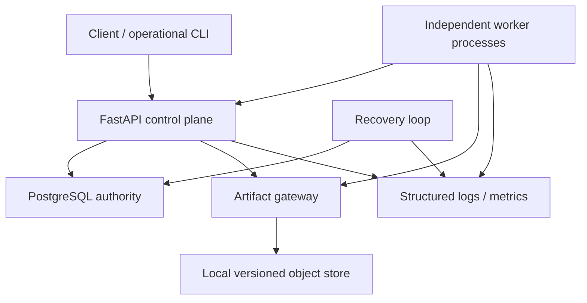

# Relay V1 — system contract

Contract version: 1.0, 2 October 2026. Status: accepted architecture baseline with the M0 clarifications below; execution runtime remains unimplemented. M0 infrastructure evidence is separate in M0_EVIDENCE.md. Changes to safety semantics require a documented contract revision and corresponding tests. This package is scoped exclusively to Relay.

The accepted M0 clarifications A1–A3 are recorded in [decisions/2026-10-02-m0-contract-amendments.md](decisions/2026-10-02-m0-contract-amendments.md). They strengthen/clarify contract 1.0 without changing its primary guarantee.

## Purpose and guarantee

Relay executes independent, partitioned batch work on multiple processes. A job has an immutable definition and a finite, atomically created partition set. Each claim creates a new attempt generation. Attempts may execute repeatedly. **At most one accepted result exists for each partition of an immutable job version.** An expired attempt cannot newly publish; an older generation cannot displace an accepted result. Accepted results are never replaced, including after cancellation.

This is not exactly-once computation or exactly-once external side effects. Workloads must be deterministic, trusted, and free of externally visible writes except through Relay's artifact protocol. Sending email, charging cards, or mutating another database is outside this guarantee.

The acceptance linearization point is the final fenced database mutation inside a transaction that subsequently commits. Lease validity is evaluated there using freshly sampled DB time after acquiring locks. It is NOT a guarantee that the lease remains unexpired at response delivery or at the physical instant WAL commits. A process or DB can pause between validation and commit. While paused with locks held, reassignment and cancellation cannot pass it. If it aborts, acceptance never occurred. This precise definition avoids an unenforceable wall-clock promise.

## Architecture

### Live attempt ownership — canonical predicate

Renewal, fresh owner failure reporting, live-attempt artifact reservation and new result publication require **live attempt ownership**. All of the following must hold together:

- job status = `RUNNING`;
- partition status = `RUNNING`;
- partition generation = supplied generation;
- supplied attempt is the partition's current/latest attempt;
- attempt generation = supplied generation;
- attempt worker session = authenticated worker session;
- attempt status = `ACTIVE`;
- `t < attempt.lease_expires_at`;
- `t < attempt.hard_deadline_at`.

`t` is one database-time sample from `clock_timestamp()`, taken **after the final potentially blocking authoritative-state lock has been acquired**. Operations may add stricter predicates, never weaken this definition. The first valid claim atomically changes the job from QUEUED to RUNNING, so an ACTIVE attempt implies its job is RUNNING. QUEUED is valid for initial claim selection, not for these live-owner operations.

Historical acknowledgments create no new authority. In particular, exact replay of an already accepted result is checked before current ownership/job-status predicates and may acknowledge that acceptance after job cancellation.

The artifact gateway is a module and streaming endpoint in the control-plane service, not another required deployed product. Workers have no DB credentials and no object-store write/delete credentials. They read registered immutable inputs through the gateway. Only gateway credentials can create output objects; no runtime credential may delete object versions. PostgreSQL is the sole result authority. Object existence is not job completion. Recovery can run as a separate process using the same transition service. Multiple recovery instances are safe under the same row-lock protocol.

## Final technology choices

| Concern | V1 choice | Reason |
|---|---|---|
| Runtime | Python 3.12, independent worker OS processes | Straightforward failure control and workload ecosystem |
| API | FastAPI, Pydantic | Explicit validated contracts |
| Authority | PostgreSQL 18, one primary, durable volume | Transactions, row locks, constraints |
| Persistence | SQLAlchemy 2, psycopg 3, Alembic | Explicit transaction boundaries and migrations |
| Artifacts | Local S3-compatible store; MinIO first candidate | Version-pinned immutable output protocol; compatibility gate below |
| Columnar workload | PyArrow, pinned release | Deterministic tabular input/output |
| Tests | Pytest against real PostgreSQL and store | No SQLite substitution for concurrency tests |
| Deployment | Docker Compose | Reproducible local services without paid infrastructure |
| Visibility | JSON logs and Prometheus-format endpoint | No tracing stack required for correctness |

Exact image digests and dependency patch versions must be locked in milestone M0 after compatibility checks; do not use floating `latest`. A MinIO build is acceptable only if the storage tests pass. S3 documentation establishes the intended protocol, not a claim that any compatible store implements it identically. OpenTelemetry/Jaeger are deferred. No Redis, broker, Kubernetes, Celery, or cloud service is required.

## V1 bounds and defaults

Single trusted installation and workload registry; shared worker authentication plus per-boot session identity. One executing attempt per worker session. One workload version supported per deployment; a submission with a different workload digest is rejected. Concurrent job execution is allowed. Maximum 4,096 partitions/job, maximum 256 MiB/output object, maximum 1 MiB canonical job descriptor, maximum 32 concurrent registered worker sessions by configuration. Larger datasets use many bounded input shards. Empty inputs are valid and produce one empty-output partition; zero partitions is invalid.

Lease duration 30 seconds, renew every 10 seconds with monotonic local timers; recovery poll 1 second, batch 100 candidates; retries default maximum 5 total attempts, configurable 1–10. Retry backoff after failed/expired generation g: min(2^(g-1), 30) seconds, no jitter in baseline. No lease extensions beyond maximum attempt lifetime of 600 seconds, configurable 60–3,600 at job creation. Every claim, including lost claim responses, consumes an attempt. Repeating a request does not consume another attempt.

DB lock timeout 2 seconds, statement timeout 5 seconds, idle-in-transaction timeout 5 seconds; explicit rollback on exceptions. These protect liveness but are not the safety mechanism. Store verification and computation never happen inside state-changing DB transactions.

## Inputs, partitions, output and versioning

The input-import gateway records immutable input object versions, SHA-256, size, schema and row-group/row counts. Job submission references verified input artifact IDs; mutable local paths and arbitrary URLs are rejected. A deterministic partition manifest maps disjoint input row groups or record ranges to partition ordinals. The API checks full coverage, no overlap, supported schema and limits before atomic submission. CSV is imported into canonical Parquet first using fixed parsing rules. V1 submission accepts a bounded precomputed manifest; it does not scan a multi-gigabyte input while holding DB locks.

Job definition digest covers input versions and hashes, workload/container digest, workload version, parameters, partition plan, schema and retry/lease policy. Job `version` is fixed at 1 in V1. Reprocessing creates a new job ID with an optional parent_job_id. There is no reset or reopening of a terminal partition.

One output per attempt: `/jobs/{job_id}/partitions/{ordinal}/attempt-{generation}/{artifact_id}/output.parquet`. Artifact ID and identity are reserved in the DB before upload. Use conditional create and pin the returned store version ID. Readback verification computes SHA-256 over actual bytes and validates Parquet readability/schema. ETag and worker-supplied metadata are not proofs of SHA-256. Result manifest references artifact ID, whose immutable metadata includes the version ID, hash and size. Only accepted manifests are used by consumers. Partial results may be inspected, but job output is advertised as complete only for SUCCEEDED jobs.

All uploads flow through the gateway. A retry streams/reads the same reserved object; an existing object with a different hash yields a conflict. A crash after the store write but before metadata commit is reconciled by inspecting the reserved key/version and verifying bytes. No runtime deletes, key reuse, lifecycle expiration or orphan GC in V1. This deliberately trades disk usage for simpler correctness. Storage administrators remain trusted. Loss of a volume is not covered by worker-failure recovery.

After acceptance, reads address the exact pinned version and verify expected integrity. A detected mismatch/corruption returns an explicit integrity failure and emits structured logs and appropriate metrics. Accepted result metadata remains immutable: no silent substitution or automatic recomputation of a terminal partition. Durable, deduplicated, queryable integrity-incident persistence is deferred beyond V1; no V1 API or schema promises that subsystem.

## Reference workload

Generate deterministic order records: record_id, customer_region, category, quantity, amount_cents, event_date, with seeded whitespace/case variations and a fixed invalid-row fraction. Normalize with documented Unicode normalization, trim/case rules and ISO date parsing; classify invalid rows deterministically. Aggregate valid records by normalized region/category/date using integer counts, quantity sums and signed 64-bit cents sums with checked overflow. Sort result groups lexicographically and emit fixed-schema Parquet plus counters. No floating-point reduction. Each partition aggregates its own disjoint input records. A separate client-side reference reducer combines partition aggregates; a distributed global reduce stage is not claimed. Compare canonical decoded rows against an independently written serial oracle; Parquet byte hashes are integrity identifiers, not a cross-version semantic equality claim.

## Explicit assumptions and non-goals

Assume committed PostgreSQL state is durable; no split-brain primary; all writers obey the transition protocol; storage preserves pinned versions; DB host wall clock is reasonably managed; workers are trusted but may crash, pause and retry. Backward DB clock jumps can delay expiry and forward jumps can force early expiry; generation fencing still prevents replacement of accepted results. No real-time recovery SLA under unbounded outages or DB stalls.

Non-goals: arbitrary DAGs, stream processing, untrusted code sandboxing, Byzantine workers, multi-tenancy isolation, multi-region consensus, autoscaling, cloud deployment, automatic data-loss restoration, preemption, universal external-side-effect idempotency, and global output transactions spanning PostgreSQL and object storage.

## Reading order and source basis

Read INVARIANTS, STATE_MACHINES, DATABASE, FAILURE_MODEL, API, TEST_PLAN, BENCHMARK_PLAN, then IMPLEMENTATION_PLAN. PostgreSQL row locks, not process mutexes, provide inter-process exclusion. `SKIP LOCKED` is suitable for queue candidates, but not a fairness proof. The DB clock function must be `clock_timestamp()`, not transaction-start `now()`.

Primary references checked 2 October 2026:

- https://www.postgresql.org/docs/18/explicit-locking.html — lock semantics.
- https://www.postgresql.org/docs/18/sql-select.html — SKIP LOCKED limitations.
- https://www.postgresql.org/docs/18/functions-datetime.html — transaction time versus current clock.
- https://www.postgresql.org/docs/18/transaction-iso.html — isolation behavior.
- https://docs.aws.amazon.com/AmazonS3/latest/userguide/conditional-writes.html — conditional object creation.
- https://docs.aws.amazon.com/AmazonS3/latest/userguide/versioning-workflows.html — explicit object-version identity.

These sources justify primitives; Relay's policy and proof obligations are original design decisions specified here. No benchmark result or completed implementation is implied.
